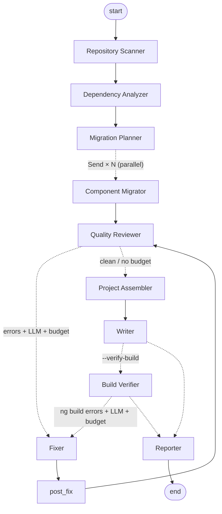

# Polymer → Angular 21 Migration Agent

A **LangGraph multi-agent application** that scans a Polymer (1.x, 2.x or 3.x) application repository and
migrates it to an **Angular 21** workspace: standalone components, signals (`input()`, `model()`,
`output()`, `computed()`, `effect()`, `viewChild()`), built-in control flow (`@if`, `@for`, `@switch`),
zoneless change detection, `OnPush`, and Angular Material in place of `paper-*`/`iron-*` elements.

It works fully offline with a deterministic rule engine, and can optionally use an LLM (Azure OpenAI,
OpenAI, Anthropic, Ollama, Google) to refine each component and repair build/review errors.

## Architecture



| Agent | Responsibility |
|---|---|
| **Repository Scanner** | Walks the repo (local path or git URL), skips `node_modules`/`bower_components`/tests, parses every `<dom-module>`, `Polymer({...})`, `class extends Polymer.Element / PolymerElement`, behaviors, class mixins, shared style modules and `index.html`. |
| **Dependency Analyzer** | Merges split definitions (template in `.html`, class in `.js`), inlines behaviors/mixins, builds the element dependency graph, detects root elements, third-party elements, CSS mixins and complexity. Optional LLM migration-strategy summary. |
| **Migration Planner** | Decides file layout (`src/app/components|pages/<tag>/<tag>.ts`), class names, and each element's public API (input vs model vs signal vs computed, outputs) so parents and children agree. |
| **Component Migrator** | Runs **in parallel** (LangGraph `Send`) per element: converts template, script and styles by rules, then (optionally) asks the LLM to refine. LLM output that breaks the public contract (selector, class, inputs/models/outputs) is rejected. |
| **Quality Reviewer** | Static checks: leftover Polymer syntax, unbalanced code, `viewChild` refs without `#ref`, template calls to non-existent members, legacy `*ngIf`/decorators, unsupported `@apply`. |
| **Fixer** | LLM-assisted repair loop driven by reviewer findings or `ng build` errors, bounded by `--max-fix-iterations`. |
| **Project Assembler / Writer** | Generates the Angular 21 workspace (`package.json`, `angular.json`, `app.config.ts` with `provideZonelessChangeDetection()`, router, `HttpClient`, root `App`, global/shared SCSS, `polymer-compat.ts` helpers) and copies static assets to `public/`. |
| **Build Verifier** | Optional `npm install` + `ng build`; compiler errors are mapped back to components and fed to the Fixer. |
| **Reporter** | Writes `MIGRATION_REPORT.md` and `migration-report.json` with per-component status, TODOs, notes and findings. |

## Quick start

```bash
python3 -m venv .venv && source .venv/bin/activate
pip install -e ".[dev]"            # add ,azure / ,openai / ,anthropic / ,ollama for LLM mode

# Rule-based migration of the bundled Polymer 2 sample
polymer2angular migrate -s examples/polymer2-shop -o migrated/shop

# Also install deps + run `ng build` and feed errors back into the agents
polymer2angular migrate -s examples/polymer3-todo -o migrated/todo --verify-build

# Migrate straight from a git repository
polymer2angular migrate -s https://github.com/org/polymer-app.git --branch main -o migrated/app

# Inspect what will be migrated (scan + analysis + plan as JSON), or print the agent graph
polymer2angular analyze -s examples/polymer2-shop
polymer2angular graph
```

Then run the generated app:

```bash
cd migrated/shop && npm install && npm start
```

### LLM-assisted mode

```bash
# Azure OpenAI (model = deployment name)
export AZURE_OPENAI_ENDPOINT=https://<resource>.openai.azure.com/
export AZURE_OPENAI_API_KEY=...            # or use Entra ID via your environment
export OPENAI_API_VERSION=2024-10-21
polymer2angular migrate -s ./my-polymer-app -o migrated/app \
  --llm-provider azure_openai --llm-model <deployment> --verify-build --max-fix-iterations 3

# Any provider supported by langchain's init_chat_model
export P2A_LLM_PROVIDER=openai P2A_LLM_MODEL=gpt-4.1
polymer2angular migrate -s ./my-polymer-app -o migrated/app
```

| Option | Description |
|---|---|
| `--llm-provider` / `P2A_LLM_PROVIDER` | `azure_openai`, `openai`, `anthropic`, `ollama`, `google_genai`, … or `none` (default: rule-based only) |
| `--llm-model` / `P2A_LLM_MODEL` | Model name (Azure: deployment name) |
| `--temperature` / `P2A_LLM_TEMPERATURE` | Optional; omitted by default for models that reject it |
| `--verify-build` | Run `npm install` + `ng build --configuration development` and loop errors back to the Fixer |
| `--max-fix-iterations` | Bound for reviewer/build → fixer loops (default 2) |
| `--dry-run` | Run all agents without writing files |
| `--exclude DIR` | Extra directory names to skip while scanning |

## What gets migrated

| Polymer | Angular 21 |
|---|---|
| `properties` (public) | `input()` (`booleanAttribute`/`numberAttribute` transforms) |
| `notify: true`, or written by the element / bound two-way | `model()` |
| private (`_x`) / `readOnly` / undeclared template properties | `signal()` |
| `computed: 'fn(a, b)'` | `computed(() => this.fn(this.a(), this.b()))` |
| `observer`, `observers: [...]` (incl. `a.*`, `a.splices`) | `effect()` + `untracked()` (old value preserved; Polymer's undefined-guard semantics) |
| `this.fire()` / `dispatchEvent(new CustomEvent())` | `output()` + `.emit(detail)`; parents receive `{ detail: $event }` so `e.detail` code keeps working |
| `this.prop = x`, `+=`, `++` | `this.prop.set(x)` / `.update(...)` |
| `this.set/get/push/pop/shift/unshift/splice/notifyPath` | Immutable signal helpers in `shared/polymer-compat.ts` |
| `this.$.id`, `this.$$()`, `this.shadowRoot`, `Polymer.dom()` | `viewChild('id')` + `#id`, `ElementRef` host |
| `ready` / `connectedCallback`/`attached` / `disconnectedCallback`/`detached` | `ngAfterViewInit` / `ngOnInit` / `ngOnDestroy` |
| `listeners`, `hostAttributes`, `reflectToAttribute`, `addEventListener('x', this.h)` | `host: { '(x)': ..., '[attr.y]': ... }` |
| `this.async`, `this.debounce`, `afterNextRender`, `importHref` | `setTimeout`, `Debouncer`, Angular `afterNextRender`, removed (bundled) |
| `[[x]]`, `{{x}}`, `attr$=`, `class$=`, `on-tap` | `{{ x() }}`, `[prop]`, `[attr.x]`, `[class]`, `(click)` |
| `{{x::input}}` on native elements; `{{x}}` to child `notify` props | `[value] + (input)="x.set(...)"`; `[(x)]="sig"` |
| `dom-if` / `dom-repeat` (as, index-as, filter, sort) / `dom-bind` | `@if` / `@for` (+ generated `computed` view for filter/sort) / unwrapped |
| `<slot name>` / `<content select>` | `<ng-content select="[slot=name]">` |
| `e.model.item` in repeat handlers | Extra `model` argument passed from the template |
| `iron-ajax` | `HttpClient` request method + config `computed` + `auto` `effect`, `takeUntilDestroyed` |
| `app-location` / `app-route` / `iron-pages` | Router-driven `route`/`routeData` signals (`matchRoute`) + `@switch`; `href="[[rootPath]]x"` → `routerLink` |
| `paper-button`, `paper-icon-button`, `iron-icon`, `paper-input`, `paper-checkbox`, `paper-toggle-button`, `paper-card`, `paper-spinner`, `paper-progress`, `app-toolbar`, … | Angular Material equivalents (imports added automatically) |
| Behaviors / class mixins | Inlined into each component (report suggests extracting services) |
| Shared style modules, `@apply` mixins, iron-flex-layout, `::slotted`, `/deep/` | SCSS partials via `@use`, inlined declarations, `::ng-deep` |
| Unknown third-party custom elements | Kept as web components with `CUSTOM_ELEMENTS_SCHEMA` (+ TODO) |

Anything that can't be translated faithfully is left in place with a `TODO(migration)` comment and listed in
`MIGRATION_REPORT.md`.

## Examples & verification

`examples/polymer2-shop` (Polymer 1 legacy + Polymer 2 classes, HTML imports, behaviors, routing, iron-ajax,
paper elements) and `examples/polymer3-todo` (Polymer 3 ES modules, `html` templates, class mixin, shared
style module) both migrate with zero review findings, compile with `ng build` on Angular 21, and were
exercised in a browser (routing, deep links, 404, HTTP data, two-way bindings, events, cart/todo flows).

```bash
pytest            # unit + end-to-end graph tests (no network / LLM needed)
```

## Project layout

```
polymer2angular/
  graph.py              LangGraph StateGraph, supervisor routing, Send fan-out
  state.py              Shared state schema + reducers
  agents/               scanner, analyzer, planner, component_migrator, reviewer, fixer,
                        assembler, writer, build_verifier, reporter
  parsing/              Polymer 1/2/3 parser (dom-module, Polymer({}), classes, behaviors, mixins)
  transform/            template / script / style converters + component assembler
  scaffold/             Angular 21 workspace generator + polymer-compat runtime helpers
  utils/                JS lexical scanner, formatting-preserving HTML tree, naming
examples/               Sample Polymer 2 and Polymer 3 apps
tests/                  pytest suite
```

## Known limitations

- Generated TypeScript uses `strict: false` because Polymer sources are untyped; tighten incrementally.
- Behaviors/mixins are inlined per component; extracting shared services is left to the developer (or LLM mode).
- `iron-pages` becomes `@switch` (inactive pages are destroyed rather than hidden).
- Polymer bubbling/composed events become direct `output()` bindings; ancestors that listened for bubbled
  events must bind on the direct child.
- Dynamic Polymer paths (e.g. `this.set(pathVar, v)`) and uncommon APIs are flagged with `TODO(migration)`.
